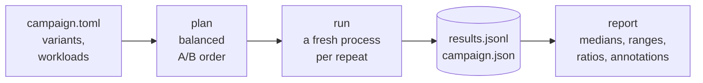
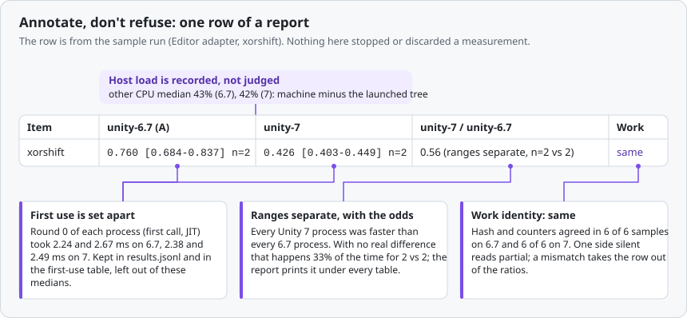
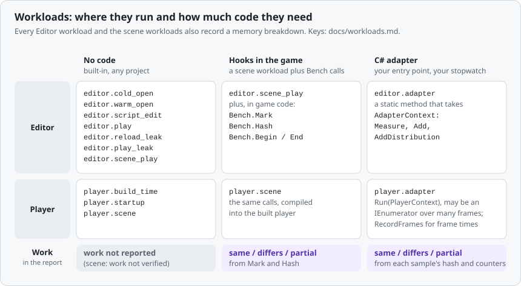
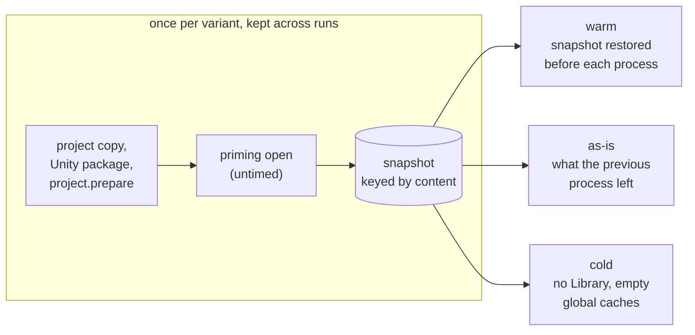
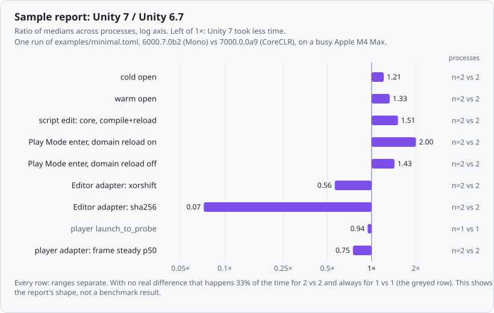
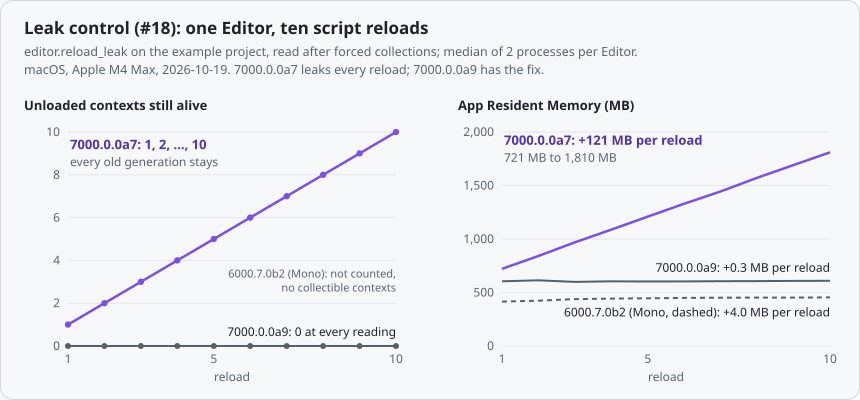
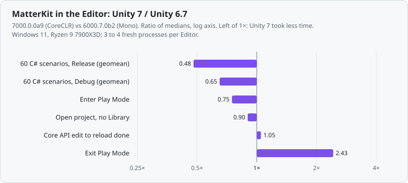
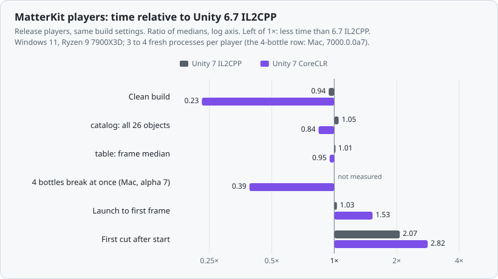

# Unity Bench

[](https://github.com/tesselworks/unity-bench/actions/workflows/python.yml)
[](https://github.com/tesselworks/unity-bench/releases/latest)
[](LICENSE)
[](pyproject.toml)

Compare the same Unity project across Editor versions or player scripting backends. It was built for a Unity 6.7 (Mono) vs Unity 7 (CoreCLR) comparison; MatterKit, a physics and fracture library, is its first consumer (its adapters live in its own, private repository).

## How it works



A campaign names the variants (a project revision, an Editor, a player backend) and the workloads. The order is fixed before anything runs, every repeat is a new process with a timeout, and the raw rows are never filtered: `unity-bench report` regenerates the summary from them at any time, with other options. Details: [methodology](docs/methodology.md).

## Annotate, don't refuse

<picture>
  <source media="(prefers-color-scheme: dark)" srcset="docs/figures/annotated-row-dark.svg">
  
</picture>

Nothing blocks a run and nothing is deleted. Host CPU and memory are recorded next to each process; work and output hashes are compared and flagged, with the coverage that backs "same"; first-use samples are labelled; every run records the commits, Editors and player settings that produced it.

## Quickstart (about 5 minutes)

You need Python 3.11+, one or more Unity Editors with a valid license, and either a checkout of this repository or `pip install .` from one. `psutil` is optional and adds host CPU/memory annotations (`pip install psutil`).

1. Copy `examples/minimal.toml` and set the `editor` paths of your two Editors (and `baseline`).
2. Look at the schedule without running anything:

   ```sh
   python3 unity-bench.py plan examples/minimal.toml
   ```

3. Run it. Start small: set `repeats = 2` and `rounds = 3` in `[defaults]`. (With more than two variants, `repeats` is raised to an even number so that every pair runs in both orders equally often; `plan` says so.)

   ```sh
   python3 unity-bench.py run examples/minimal.toml
   ```

   The run directory (default `bench-runs/<name>-<time>/`) gets `results.jsonl` (raw), `campaign.json` (what was run and with which commits), `summary.md`, `summary.json`, and every Editor log. The project is copied per variant, so your working tree is never touched. The command runs everything it can and then exits 0, or 3 if a process failed or a variant ended up without samples (2 means a usage or configuration error).

4. Regenerate the report from raw data at any time, with other options:

   ```sh
   python3 unity-bench.py report bench-runs/minimal-example-... --first-use-ratios --bootstrap 1000
   ```

5. Run it again. The second run does not prepare the project copies: it restores the prepared copies from the cache (`prepared: reused <key>` in the report), and `unity-bench cache list` shows what is kept (see [Cache states](#cache-states)).

To measure your own project: point `[project] path` at it, list your Editors under `[[variants]]`, and keep the workloads you want. Say which items are the result with `headline` on a workload; there is no aggregate over everything. For project-specific work, write an [adapter](docs/adapters.md).

`pip install .` installs the `unity-bench` command and carries the Unity package inside the wheel; `pip install -e .` (or running `python3 unity-bench.py` from a checkout) uses `packages/` in place. Unity Bench never installs Editors or Unity modules.

## Workloads

<picture>
  <source media="(prefers-color-scheme: dark)" srcset="docs/figures/workloads-dark.svg">
  
</picture>

**Zero-code start, hooks when you need verified work.** Point a `player.scene` (or `editor.scene_play`) workload at your main scene and you get frame percentiles and the profiler markers each backend offers, labelled "work not verified". Add `Bench.Mark("bodies", n)` (and `Bench.Hash`, `Bench.Begin/End`) to the game and the same workload compares your counters and reads "same" or "differs", with no rewrite as an adapter ([Scene hooks](docs/adapters.md#scene-hooks)). Details and keys: [docs/workloads.md](docs/workloads.md).

<details>
<summary>What each workload measures</summary>

| Kind | Measures |
| --- | --- |
| `editor.cold_open`, `editor.warm_open` | open the project with and without `Library` |
| `editor.script_edit` | edit a leaf / widely-referenced / public-API script: compile time, compile+reload time, assemblies compiled, and the reload breakdown parsed from the Editor log |
| `editor.play` | Enter/Exit Play Mode, with the project's settings or with domain reload disabled |
| `editor.reload_leak`, `editor.play_leak` | N script-edit reloads (default 30) or Play Mode cycles (default 10) in one Editor, with memory read after each: first and last value and the slope per cycle (MB) of managed heap, Unity native, graphics and process memory, and on CoreCLR how many unloaded code contexts are still alive |
| `editor.adapter` | your C# entry point: samples, per-frame distributions, work counters, output hash |
| `player.build_time` | `BuildPipeline.BuildPlayer`, clean or incremental, per scripting backend |
| `player.startup` | launch a built player until its probe frame (`launch_to_probe`: after the first scene loaded and two frames ran; not a presented frame) |
| `player.adapter` | your C# entry point inside a built player, over many frames: samples, p50/p95/p99/max distributions with warm-up kept apart, work counters, output hash |
| `player.scene`, `editor.scene_play` | **no code needed**: play a scene in a built player or in Play Mode and record frame time, `ProfilerRecorder` markers (main thread, PlayerLoop, physics, rendering, scripts, GC) and memory. Optional hook calls in the game make the work verified |

Every Editor workload and the scene workloads also report a memory breakdown (managed heap / Unity native / graphics / process) as an annotation ([Memory readings](docs/workloads.md#memory-readings)).

</details>

## Cache states



A later run with the same key restores the snapshot instead of preparing again. Every workload that starts an Editor names its start state (`state = "cold" | "warm" | "as-is"`), and every process records the state it really had; a state that cannot be set up runs `as-is` with a note. `cold` never touches your own caches: it points them at empty directories for that one process. The OS file cache, the GPU driver's shader cache and the GI cache are not controlled. More: [methodology](docs/methodology.md#cache-states).

## Sample report

One run of `examples/minimal.toml` on 2026-10-19: 6000.7.0b2 (Mono) against 7000.0.0a9 (CoreCLR) on an Apple M4 Max MacBook Pro that was also running other work, unity-bench 0.7.0 at `75171c1`, `repeats = 2`, 68 processes, none failed. It shows what the report looks like. It is not a benchmark result: n is 1 to 2 and the machine was busy.

<picture>
  <source media="(prefers-color-scheme: dark)" srcset="docs/figures/sample-ratios-dark.svg">
  
</picture>

The leak workloads open with their result instead of a ratio. The same report shape caught a real leak: the control run for [#18](https://github.com/tesselworks/unity-bench/issues/18) compared an Editor that leaks every script reload (7000.0.0a7) with the fixed one (7000.0.0a9) and 6.7.

<picture>
  <source media="(prefers-color-scheme: dark)" srcset="docs/figures/leak-control-dark.svg">
  
</picture>

<details>
<summary>The tables behind the charts, and what else a report holds</summary>

The run behind the first chart: the opens ran 3 repeats, `reload-leak` 10 cycles, `play-leak` 5, in 13 minutes. The load average was 20 with no Unity running just before the start and 17 to 27 in once-a-minute samples during the run; the report's host table gives machine CPU median 57% (6.7) and 67% (7), max 100%, of which about 42% was other work. Cells are median [min-max] across processes, n = processes after the first-use process is set aside; the ratio is Unity 7 / Unity 6.7.

| Item | unity-6.7 (A) | unity-7 | unity-7 / unity-6.7 | Work |
| --- | --- | --- | --- | --- |
| cold open (Library deleted, caches isolated) | 9,399 [8,871-9,926] n=2 | 11,377 [10,335-12,419] n=2 | 1.21 (ranges separate, n=2 vs 2) | not reported |
| warm open | 3,911 [3,864-3,959] n=2 | 5,199 [5,109-5,290] n=2 | 1.33 (ranges separate, n=2 vs 2) | not reported |
| core/compile+reload | 1,371 [1,261-1,481] n=2 | 2,073 [1,957-2,188] n=2 | 1.51 (ranges separate, n=2 vs 2) | not reported |
| play_enter, domain reload on | 677 [675-679] n=2 | 1,357 [1,298-1,415] n=2 | 2.00 (ranges separate, n=2 vs 2) | not reported |
| play_enter, domain reload off | 17.5 [17.2-17.8] n=2 | 25.1 [24.8-25.3] n=2 | 1.43 (ranges separate, n=2 vs 2) | not reported |
| adapter: xorshift | 0.760 [0.684-0.837] n=2 | 0.426 [0.403-0.449] n=2 | 0.56 (ranges separate, n=2 vs 2) | same |
| adapter: sha256 | 187 [187-187] n=2 | 13.4 [13.4-13.5] n=2 | 0.07 (ranges separate, n=2 vs 2) | same |
| player launch_to_probe | 377 [377-377] n=1 | 355 [355-355] n=1 | 0.94 (ranges separate, n=1 vs 1) | not reported |
| player adapter: frame steady p50 | 0.803 [0.799-0.807] n=2 | 0.599 [0.599-0.599] n=2 | 0.75 (ranges separate, n=2 vs 2) | not reported |

Under each table the report prints how often ranges separate by chance for the n involved (33% for 2 vs 2, 100% for 1 vs 1). In the same run, `reload-leak` read:

| Variant | App Resident Memory per cycle | First to last (median) | Unloaded contexts still alive (last cycle, median) | Points x processes |
| --- | --- | --- | --- | --- |
| unity-6.7 | +3.359 MB [+2.991 MB to +3.728 MB] | 414.6 MB to 448.5 MB | not counted (no collectible contexts: Mono) | 10 x 2 |
| unity-7 | +2.907 MB [+2.809 MB to +3.005 MB] | 620.0 MB to 647.4 MB | 0 of 10 | 10 x 2 |

The leak control in the second chart (framework at `4b190dd`, 2 processes per Editor, machine CPU median 36 to 39%; `reload-leak` 10 reloads, `play-leak` 5 cycles with domain reload on):

| | 6000.7.0b2 (Mono) | 7000.0.0a7 (CoreCLR, leaks) | 7000.0.0a9 (CoreCLR, fixed) |
| --- | --- | --- | --- |
| reload: `App Resident Memory` per reload | +4.0 MB [1.3, 6.6] | +121.0 MB [120.3, 121.6] (721 MB to 1.77 GB) | +0.3 MB [-1.8, 2.5] |
| reload: `Unloaded contexts still alive` after reload 1, 2, ..., 10 | not counted | 1, 2, ..., 10 (both processes) | 0 at every reading |
| Play Mode: `App Resident Memory` per cycle | +5.1 MB | +117.7 MB | +3.1 MB |
| Play Mode: `Unloaded contexts still alive` after 5 cycles | not counted | 5 of 5 | 0 of 5 |

The full report also lists the variants with their resolved project commits and Editor versions, the players' own runtime, build kind and build settings, the start state of every workload and how each prepared copy was made, first-use samples, per-phase reload tables, the memory breakdown of every Editor workload, frame and profiler-marker distributions of the scene workloads, items whose work or output differed (shown apart, left out of the ratios), a headline aggregate for the items you named, host annotations and failed processes. The raw `results.jsonl` and `campaign.json` of these runs are not in the repository (run directories stay out of git); the numbers the charts use are in [docs/figures/data](docs/figures/data).

</details>

## Case studies

**MatterKit, Unity 6.7 vs Unity 7 alpha 9.** The comparison Unity Bench was built for, run by MatterKit's own CI on one Windows PC (other jobs paused while measuring). A write-up with the method and the findings will be linked here when it is published.

<picture>
  <source media="(prefers-color-scheme: dark)" srcset="docs/figures/case-matterkit-editor-dark.svg">
  
</picture>

In the Editor, MatterKit's pure C# scenarios ran in about half the time on the CoreCLR Editor, while editing a script and waiting for the reload stayed where it was.

<picture>
  <source media="(prefers-color-scheme: dark)" srcset="docs/figures/case-matterkit-player-dark.svg">
  
</picture>

In players, CoreCLR built about four times faster and was mostly faster on long runs, but paid for JIT the first time code ran (launch, first cut); Unity 7 IL2CPP stayed close to 6.7 IL2CPP.

**Spill**, a physics incremental game (Entities, Unity Physics, URP), is the second case: the same two Editors and three player backends, measured overnight by its own CI. Its campaigns are private.

## Honest limits

- The Editor runs in `-batchmode -nographics`: no window, no GPU, no Inspector. Play Mode "frames" are updates, and player startup is headless by default and measures a probe frame, not a presented one.
- n is small. The report gives medians, ranges, "ranges separate" with n on both sides and the chance of that with no real difference (33% for 2 vs 2); it is not a significance test, and `--bootstrap` intervals are descriptive.
- Built-in Editor workloads measure the Editor on your project, not Unity in isolation.
- A newer Editor migrates the project on its first open. Since v0.4 that happens in an untimed priming open, not in a measured sample; `--no-cache` brings back the old behaviour, where that sample is labelled first-use.
- `cold` isolates what Unity lets us isolate (compilation cache, Package Manager cache, Accelerator, `Library`); the OS file cache, the GPU driver's shader cache and the GI cache are not controlled ([methodology](docs/methodology.md#cache-states)).
- Player adapters run a built player per repeat and a build per variant, so they are slow to schedule; tail percentiles of a single process are noisy, and the report shows their range across processes rather than a single number.
- Windows process ownership is verified by CI mocks and native tests on `windows-latest`. See [Tested Editors and platforms](#tested-editors-and-platforms) for what ran with real Unity.

## Tested Editors and platforms

| Editor | Editor runtime | macOS, Apple silicon | Windows x64 |
| --- | --- | --- | --- |
| 6000.7.0b2 | Mono | example campaign with 0.7.0 | consumer CI with 0.6.0 |
| 7000.0.0a9 | CoreCLR | example campaign with 0.7.0 | consumer CI with 0.6.0 |
| 7000.0.0a7 | CoreCLR | the leak control of 0.7.0 (leaks every script reload; superseded by a9) | consumer CI with 0.3.0 to 0.6.0 |

"Consumer CI" is the benchmark CI of two projects that use Unity Bench, MatterKit and Spill, on a Windows x64 machine; their campaigns are private. Player backends: the example campaign builds Mono (6.7) and CoreCLR (7) players; the consumer CI also built IL2CPP players on both Editors. The Python side is tested on Linux and Windows by this repository's CI, with a stand-in Editor. Other Editor versions and Linux Editors have not been run.

## Reproducing published results

A result made with Unity Bench can be re-aggregated without Unity from its raw `results.jsonl` and `campaign.json`, with the framework commit and report options its `summary.md` names: see [Reproducing a published result](docs/methodology.md#reproducing-a-published-result).

## Repository layout

- `src/unity_bench/` runner, process ownership (POSIX process groups, Windows Job Objects), result checking, statistics and identity, reload-log parser, report
- `packages/com.tesselworks.unity-bench/` Unity package: `Editor/` batch entry and adapter API, `Runtime/` the inert-unless-asked player side
- `examples/` a tiny Unity project with one custom adapter and a campaign that exercises every built-in workload
- `docs/` [methodology](docs/methodology.md) (including how to read results and how to reproduce a published one), [adapters and result schema](docs/adapters.md), [workloads](docs/workloads.md), [pre-release checklist](docs/public-repository.md); [CHANGELOG](CHANGELOG.md)
- `docs/figures/` the README and docs figures: `python3 docs/figures/make_figures.py` regenerates them from `docs/figures/data/`

Tests need no Unity: `python3 -I -m unittest discover -s tests`.
