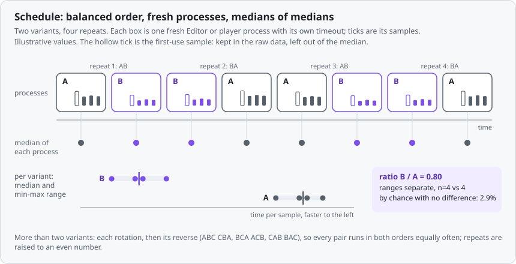
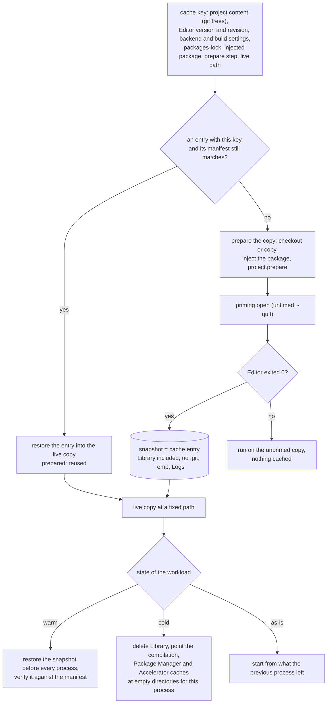
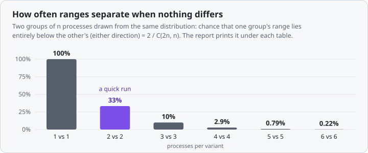

# Methodology

Unity Bench answers one question: how does the same project behave on this Editor or player backend compared with that one? The method is deliberately plain. It records what happened and tells you where to be careful. It never refuses to run and never throws a measurement away.

## Variants

A **variant** is a project revision, a Unity Editor, and a player scripting backend:

| Part | Where it comes from |
| --- | --- |
| project revision | `revision` (a git commit; the runner makes a detached worktree) or, if omitted, a copy of the project directory |
| Unity Editor | `editor`, the path of the Unity executable |
| scripting backend | `backend`: `mono`, `il2cpp` or `coreclr`. It applies to player builds and player startup. The Editor's own runtime is whatever that Editor ships and is reported by the Editor, not configured |

Every variant gets its own project copy, so Library, edits and builds never mix between variants or touch your working tree. Editor workloads can also set Editor **code optimization** (`debug` or `release`) per variant. That setting only lasts for the Editor session, so each process applies it itself (after opening, before the workload starts) and nothing leaks into your normal Editor. It therefore has no effect on `editor.cold_open` and `editor.warm_open`, which measure the open itself.

Player builds can also hold three Unity player settings equal across Editors, with a `[build]` table (campaign-wide) or a `build` table on a variant: `api_compatibility`, `il2cpp_code_generation` and `stripping`, spelled as the Editor spells the enum values. Without them the project's own settings apply, and a comparison between Editors then also compares whatever each Editor migrated or defaulted. Whatever was actually used (scripting backend, API compatibility level, IL2CPP code generation and compiler configuration, managed stripping level, development flag, graphics APIs) is read back from the Editor after it applied the request and recorded with the build; the report shows it next to the player's own environment. A setting an Editor does not have fails that build instead of being skipped quietly.

## Schedule

The schedule is fixed before anything runs (`unity-bench plan <campaign>` prints it, with a note for anything it changed on purpose):

<picture>
  <source media="(prefers-color-scheme: dark)" srcset="figures/schedule-dark.svg">
  
</picture>


- For each workload, for each repeat, the variants run in a balanced order, so that slow drift (thermal state, caches, background work) and "who ran right after whom" are spread over the variants instead of loaded onto one.
  - **Two variants** alternate: A,B then B,A then A,B, and so on.
  - **More than two variants** run each rotation followed by its reverse: for A,B,C that is ABC, CBA, BCA, ACB, CAB, BAC. Any two consecutive repeats put every pair in both orders, so every compared pair runs in both orders equally often, and `2n` repeats also put each variant in each position equally often. A plain rotation does not do this (ABC then BCA always runs A before B and B before C in the first half). Because the balance needs pairs of repeats, **`repeats` is raised to the next even number for more than two variants** (`repeats = 3` runs 4); `plan` and the report say so. With two variants an odd `repeats` ends one repeat unbalanced; that is the price of keeping the number you asked for.
- Every repeat is a **fresh process**. The process is the unit of repeat; a process may run several rounds internally.
- Every process has an explicit timeout. On timeout the whole process tree is killed (POSIX process groups, Windows Job Objects), the process is recorded as `timeout`, and the schedule continues. The wall time of a process stops when it exits (or at the timeout), before the process tree is cleaned up.
- A failed process is recorded with its exit code or error and is left out of the numbers. It does not stop the campaign and it is not retried. When the campaign has finished, `unity-bench run` exits with code 3 if any process failed, never ran or left a variant without samples, so a CI job can tell; everything that could run has run by then.
- `--only <workload>` runs just that workload, plus (once) the `player.build_time` workload it uses through `build`, because its launches have no player without it.

### What cleanup does to the machine

When a process ends, every process still alive in its group (POSIX) or job (Windows) is terminated, and the report says which ones (for example Unity's asset import workers and build backend). One class is deliberately left alone: **shared Unity daemons**, today the Unity Licensing Client. An Editor starts it, but it serves every Editor on the machine; killing it with the Editor's tree would make the next Editor pay to start it again and would take it away from the Editor you have open yourself. On Windows the licensing client cannot be allowed to "break away" from the job (the Editor creates it without the breakaway flag, and silent breakaway would let every child escape), so cleanup lists the job's members, terminates all but the shared ones, and clears the job's kill-on-close limit before closing it. On POSIX the group is signalled member by member instead of with one `killpg`. A job or group without a shared daemon, or one that cannot be listed, is still killed atomically. A surviving daemon can have a project copy as its working directory, which on Windows keeps that directory from being deleted: the runner removes the contents, retries, reports what it could not remove (`left_behind` in `campaign.json`), and a later run reuses an emptied leftover directory (it refuses one that still has files, and never deletes them for you).

## Cache states

Unity caches in many places, and "cold" used to mean only "`Library` deleted". Each workload that starts an Editor on the project (`editor.*`, `player.build_time`) now says where it starts with `state`, and every process records the state it actually had.



| State | The process starts from | Default for |
| --- | --- | --- |
| `cold` | `Library` deleted, and the global caches below pointed at empty directories made for that one process | `editor.cold_open` |
| `warm` | the snapshot taken after the variant's copy was prepared and imported: the whole copy (Assets, ProjectSettings, Packages, `Library`) is put back before every process | nothing; ask for it |
| `as-is` | whatever the previous process left | every other workload, as before v0.4 |

`warm` is what makes repeats comparable: every process starts from the same state instead of from whatever the previous one left (a `warm_open` after a script edit workload, a Play Mode process after a build). `as-is` stays the default because some workloads are meant to build on each other (an incremental build starts from the cache the clean builds left).

The record is in `results.jsonl` (`state` on each process row: requested and actual state, snapshot key, restore time and method, whether the restored copy matched the snapshot, the isolated caches, and the Editor's own count of assets imported at open, read from its log) and in the report ("Start states and prepared copies"): `warm (snapshot <key>)`, `cold (Library removed; isolated: compilation, upm, accelerator)`. A state that could not be set up is not an error: the process runs from what is there and says so (`requested warm, actual as-is`, with the reason).

### Prepared copies, snapshots and reuse

Preparing a variant's copy used to repeat in every campaign: copy or check out, inject the package, run `project.prepare`, and import everything in the first measured open (about 3.5 minutes per variant and campaign in the first Windows session). Now:

1. After `project.prepare`, an untimed **priming open** (`-quit`, recorded as a `prepare` row, not a process) imports the project and, on a newer Editor, migrates it.
2. That state is **snapshotted** (the copy's root without `.git`, `Temp` and `Logs`, `Library` included) as a cache entry. Only a clean point is snapshotted: the Editor exited 0. A failed priming open is recorded, nothing is cached, and the schedule runs on the unprimed copy (as in v0.3).
3. The next run, or the next campaign of a session, finds the entry by its **key** and restores it instead of preparing: `prepared: reused <key>` instead of `prepared: built (N s)`.

The key is made of everything that decides what the prepared state is: the content of the project (for a `revision` variant: the git tree of the project directory at the resolved commit, or for a project at the repository root the trees of `Assets`, `Packages` and `ProjectSettings`; plus the tree or blob of every `file:` package the project's `Packages/manifest.json` names, resolved from its `Packages` directory; a `file:` path outside the repository is keyed by a digest of its files' paths, sizes and times; for a plain copy, a digest of the files' paths, sizes and times and the commit it is at), the full Editor version with its revision, the variant's backend and `build` settings, the digest of `Packages/packages-lock.json`, the digest of the injected Unity package, the digest of the prepare step (the commands, the files they name and `project.prepare_inputs`, see [workloads.md](workloads.md#preparing-the-project-copy)), and **the absolute path of the live copy**. The path is in the key because Unity's `Library` holds absolute paths: a primed project opened from another directory recompiled all its scripts (31 s instead of 0.5 s on the example project, 6000.7.0b2 on macOS). So the live copies sit in a fixed place, `<cache dir>/w/<variant id>` by default or whatever `--work` names, and a different `--work` is a different entry.

**The commit of a `revision` variant is not in the key.** The key says what the Unity project and its local packages contain, so a commit that changes only `.github/`, a README or another package the project does not reference finds the same entry; any change under the project, in `Packages/manifest.json` or inside a referenced local package makes a new key. The commit is recorded in the provenance and shown in the report. When a copy made at an older commit is reused, the provenance names this run's commit and keeps the other as `prepared_from_commit`, and the checkout of the live copy is that older commit (identical in everything Unity reads). Limits: files in the repository that a `project.prepare` command reads from outside the project are not in the key (list the ones that matter in `project.prepare_inputs`, which are read from the campaign's own checkout), and a git submodule inside the project or a package counts as its pinned commit, not its files.

Guards against a prepared copy that is no longer what its key says:

- Each entry stores a **manifest**: the top level of the copy, the SHA-256 of every `ProjectSettings` file and of the package manifest and lock, the size of the top-level files, (files, bytes, newest time) of `Assets` and `Packages`, and the top level of `Library` with the size and time of `Library/ArtifactDB` and `SourceAssetDB`. It is compared again before the entry is used. If anything differs, the entry is discarded and the copy is prepared again (`prepared: built ... the cached copy was not used: files changed since the snapshot: ProjectSettings/EditorSettings.asset`).
- After every restore the live copy is compared with the same manifest (`verified` on the process row); a mismatch is restored once more and then recorded.
- Every process row lists the settings files the Editor rewrote during that process (`settings_changed`), and the entry records which ones the priming open changed.
- A key is exact, not approximate: touching a source file of a plain copy changes it (a re-preparation, never a stale reuse).

The manifest is cheap on purpose (a few hundred KB hashed, a stat of the project's own files); it does not hash `Library`. It detects edits, deletions and a half-made copy, not a bit flip inside a cache file.

Restoring replaces the whole top level of the live copy by a copy of the snapshot. On macOS that is an APFS clone (`clonefile`, no data is copied; writes of either side diverge, nothing is hard-linked) and takes well under a second for a small project. On Linux it is `cp --reflink=auto` (a reflink on btrfs and XFS, a plain copy elsewhere). On Windows it is a parallel copy through the OS copy call, which clones blocks on ReFS and Dev Drives where Windows does so and is a plain copy on NTFS; long paths use the `\\?\` prefix, and deleting is retried while the Editor's children still hold files. The method and time are recorded per process (`restore_method`, `restore_ms`).

`unity-bench cache list` shows the entries (key, Editor, variant, source, size, last use, how often reused); `unity-bench cache prune [--older-than 30d] [--keep N] [--dry-run]` deletes by age and count. An entry is the size of the project plus its `Library`; on a file system without clones, the live copy and the entry each take that much. `--cache-dir` (or `UNITY_BENCH_CACHE_DIR`) chooses the directory, `--no-cache` goes back to v0.3 (prepare everything, keep nothing; a `warm` workload still gets a snapshot for that run).

### What `cold` isolates

`cold` deletes `Library` and sets the following for that one Editor process. The directories are empty and private to the process (a fresh temporary directory, deleted afterwards), so the user's real caches are neither read nor written. A campaign chooses the set with `[cache] isolate = ["compilation", "upm", "accelerator"]` (the default; `[]` makes `cold` only delete `Library`).

| Cache | Where it lives | Isolated by | Evidence (macOS, 6000.7.0b2 and 7000.0.0a7) |
| --- | --- | --- | --- |
| Script compilation cache (Bee; "Compilation cache" in Preferences) | `~/Library/Unity/cache/bee` (macOS) | `BEE_CACHE_DIRECTORY` | A cold process's log ends with `Total cache size 143611` (6000.7.0b2) / `147627` (7000.0.0a7), the size of the empty directory; a normal process on the same project prints `267305024`, the user's. Three cold opens in a row printed the same size, and the user's directory kept its file count, size and newest modification time |
| Package Manager global cache (registry tarballs, git checkouts, package database) | `~/Library/Unity/cache/{npm,packages}` and `~/Library/Caches/Unity/upm` (macOS) | `UPM_CACHE_ROOT` | The empty directory receives `db`; in a project with `com.unity.postprocessing` (not shipped with the Editor) it grew to 48 MB, the first open took 21.5 s / 19.2 s against 8.4 s / 8.9 s for the second, and the user's caches were untouched. The Editor itself says "The Packages Cache location is set by environment variable UPM_CACHE_ROOT" |
| Accelerator / cache server (shared asset import results and shader cache) | a server, when the project or the user's preferences name one | `-cacheServerEnableDownload false -cacheServerEnableUpload false` | Off by default. Both Editors accept the arguments and their logs report `Imports: total=N (actual=N, local cache=0, cache server=0)`; not tried against a real Accelerator |
| Imported assets, shader cache (`Library/ShaderCache`), Burst cache (`Library/BurstCache`), Bee artifacts, `PackageCache`, IL2CPP and build caches | inside the project's `Library` | deleting `Library` | A cold open's log says `Imports: total=43 (actual=43, local cache=0, cache server=0)`, a warm one `total=0` |

The variables are not specific to an OS, and Unity's own defaults for the locations differ (the Windows and Linux ones were not looked up here). On Windows and Linux the isolation uses the same variables and arguments, but only macOS was verified.

Not isolated:

- **GI cache** (`GICacheFolder`): an Editor preference (`GICacheFolder`, shared by all projects) with no command-line switch or environment variable that we found in either Editor. It only matters for workloads that bake lighting. Its default location per OS was not looked up.
- **Asset Store cache** (`ASSETSTORE_CACHE_PATH` exists, but nothing in these workloads reads it) and the MSBuild project cache (`UNITY_MSBUILD_PROJECT_CACHE_DIR`): not touched, not verified to matter.
- The **OS file cache** and, with a window or a player, the **GPU driver's shader cache**: not controllable from here. A first open after a reboot pays for the first. This is why the first process of a workload is labelled first-use.
- Per-user settings (the Editor's preferences, licensing) are deliberately left alone. Redirecting `HOME` would be the blunt way to isolate everything, but it would also move the license and preferences that Unity finds there; that was not tried.
- With `upm` isolated, a project with registry packages downloads them for every cold process (the Editor ships some offline; the rest come from the network). That is the cost of a first open on a clean machine, and it makes cold opens depend on the network; drop `upm` from `isolate` for a campaign that must run offline.

## What is measured

Built-in workloads measure wall time with the clock described in [workloads.md](workloads.md): the whole Editor process for opens, in-Editor stopwatches for edits, Play Mode and builds, a file timestamp for player startup. Project adapters bring their own stopwatch around exactly the work they care about ([adapters.md](adapters.md)). Where a script reload spends its time is parsed from the Editor log ([Reload breakdown](workloads.md#reload-breakdown)).

Each measurement is a **sample** with a name, a `phase` and milliseconds. The phase says what kind of execution it was:

| Phase | Meaning |
| --- | --- |
| `first-use` | the first time something runs in a process (first round, first open of a project copy, first launch of a build). It pays one-off costs such as JIT, caches, project import and migration on a newer Editor, and code signing checks |
| `warm` | it ran again after a first use in the same process (or the workload defines it as a repeat of an already-used thing) |
| `warmup`, `steady` | labels an adapter gives to the early and the settled part of a long series |
| `single` | a name measured once in a process. It is neither first-use nor warm: nothing was repeated, so nothing is claimed |

An adapter may tag a sample with any of the first four. An untagged sample is classified by the runner from how often its name occurs in the process (first-use for the first of several, warm for the rest, single for one), so a single execution is never called warm unless the adapter says so. First-use samples are labelled, kept in `results.jsonl`, listed in the report (as raw samples, or as a table of ratios with `report --first-use-ratios`), and **excluded from the steady-state summary by default**. `report --include-first-use` (or `defaults.exclude_first_use = false`) includes them. When the story is startup or JIT (the first Play Mode entry after an edit, the first spawn of a new object kind), the first-use table is the result, not a footnote.

## Profiler markers per backend

The scene workloads ([workloads.md](workloads.md#playerscene-and-editorscene_play)) record `ProfilerRecorder`s, and which ones exist is a property of the process that runs the scene, not of the workload. The report lists, per variant, what was recorded and what was not; this is what it showed on macOS (Apple silicon), Unity 6000.7.0b2 and 7000.0.0a7, in the example project (built-in render pipeline, Metal):

| Process | Recorders offered | The workload recorded | Not offered |
| --- | --- | --- | --- |
| Editor, batchmode `-nographics`, 6.7 Mono and 7 CoreCLR (`editor.scene_play`) | about 3,500 | all 22 wanted | none. The rendering markers exist but never run without a GPU, so they read 0 |
| Development player, 6.7 Mono and 7 CoreCLR (`development = true`) | about 2,500 | all, but the script and fixed-update markers have their player names `BehaviourUpdate` and `FixedBehaviourUpdate` | `Update.ScriptRunBehaviourUpdate`, `FixedUpdate.PhysicsFixedUpdate` (the same work, another name) |
| Release player, 6.7 Mono, 6.7 IL2CPP, 7 CoreCLR, 7 IL2CPP | 62 (63 on 7: also `Draw Calls Count`); the same list on every backend of one Editor | `Main Thread`, `PlayerLoop`, `RenderLoop`, `Gfx.WaitForPresentOnGfxThread`, `Gfx.WaitForRenderThread`, `SetPass Calls Count`, `Triangles Count`, `Vertices Count`, `GC.Collect`, `GC Used Memory`, `GC Reserved Memory`, `Total Used Memory`, `App Resident Memory` | scripts (`Update.ScriptRunBehaviourUpdate`/`BehaviourUpdate`, `FixedUpdate...`), `Physics.Simulate`, `Physics2D.Simulate`, `Culling`, `Camera.Render`, `GC.Alloc`, `GC Allocated In Frame`, `GC Allocation In Frame Count` |

- In a Release player there is no physics, script or allocation marker; `development = true` brings them back, but a Development player is slower and is not what ships, so compare like with like. There is no difference between Mono and IL2CPP in what is offered; Unity 6.7 and 7 differ only by `Draw Calls Count`.
- Backends differ in the managed side the workload also reads: `GC.CollectionCount` counts every generation alike on Mono and on 6.7 IL2CPP (the Boehm collector), 7 IL2CPP is similar, and CoreCLR counts real generations and, with this much garbage, none at all. The process's peak working set was available from `Process` only on Mono (the others report no value, and the item is missing for them); `App Resident Memory` is the level every process offers.
- In the Editor, profiler frames never close in batchmode, so `LastValue` stays 0 and the recorders accumulate. The workload detects that (a recorder with fewer than two completed samples) and takes the change since the previous frame. In a player it uses the recorder's own per-frame sample.
- A free-running player (no `capture_delta`) was paced by the engine here: the frame time p50 was 0.200 ms on 6.7 and 0.100 ms on 7 (5 and 10 kHz), the same value in every process, so the frame time says how the engine waits, not what the scene costs. With `time.capture_delta` the frames are not paced (p50 about 0.3 ms). Rendering counters were not the same across Editors for the same scene in a Development player (`Triangles Count` about 26,600 on 6.7, 4 on 7); they are reported as read and not explained.

## Memory counters

The Editor workloads and the scene workloads read the process's own memory ([workloads.md](workloads.md#memory-readings)). A reading is a list of named values from four sources, and a source an Editor does not have is listed as missing, never an error. All of it is in bytes except counts and the one time.

| Counter | What it is | Source |
| --- | --- | --- |
| `GC Used Memory`, `GC Reserved Memory` | the managed heap: bytes in live objects (and not yet collected garbage), and bytes the managed allocator holds from the OS | `ProfilerRecorder`, category Memory |
| `Total Used Memory`, `Total Reserved Memory` | everything Unity's allocators hold: used = in live allocations, reserved = requested from the OS and kept for reuse. **Total Used includes GC Used** (checked: Total Used - GC Used equals `Profiler.GetTotalAllocatedMemoryLong` to a few KB on both Editors) | `ProfilerRecorder` |
| `Unity Native (Total Used - GC Used)` | the table's "Unity native": Unity's own allocations outside the managed heap (engine, assets, loaded code and metadata, the Editor's data) | derived from the two above |
| `Gfx Used Memory`, `Gfx Reserved Memory`, `Gfx Driver (API)` | graphics memory. 0 in a `-nographics` Editor | `ProfilerRecorder`; `Profiler.GetAllocatedMemoryForGraphicsDriver` |
| `Audio`, `Video`, `Profiler`, `Physics` `Used` / `Reserved` | the subsystems' own pools | `ProfilerRecorder` |
| `Texture`, `Mesh`, `Material`, `AnimationClip`, `AudioClip Memory` and their `Count`s, `Object Count`, `Asset Count`, `Game Object Count`, `Scene Object Count`, `Sprite Count`, `SpriteAtlas Count` | what is loaded; counts that grow per reload are objects that stayed | `ProfilerRecorder` |
| `System Used Memory`, `App Resident Memory`, `App Committed Memory` | the process as the Editor sees it. On macOS `App Resident Memory` is the physical footprint (`phys_footprint`, what Activity Monitor calls Memory): what the OS charges the process for, compressed and swapped pages included. psutil's RSS (the runner's `Process RSS`) leaves out pages the OS compressed or swapped, so on macOS **RSS is not the metric for a leak**: in a 110-reload run of a leaking Editor RSS read 1.4 GB while the footprint was 13.6 GB. `App Resident Memory` is the process counter the leak workloads are read by | `ProfilerRecorder` |
| `Mono Used (API)`, `Mono Heap (API)`, `Unity Allocated (API)`, `Unity Reserved (API)` | the same quantities as GC Used, GC Reserved, Total Used - GC Used and Total Reserved, read live without a recorder: the **cross-check**. On both Editors they agreed with the recorders (the `Mono` in the name is historical: on a CoreCLR Editor `Mono Used` is the CLR heap Unity reports as GC Used) | `Profiler.GetMonoUsedSizeLong`, `GetMonoHeapSizeLong`, `GetTotalAllocatedMemoryLong`, `GetTotalReservedMemoryLong` |
| `.NET GetTotalMemory` | the runtime's own estimate of managed bytes in use. On Mono it equals `GC Used Memory`; on CoreCLR it is larger (104 MB against 72 MB right after a reload in the example project): do not mix the two | `GC.GetTotalMemory(false)` |
| `.NET Heap Size`, `.NET Fragmented`, `.NET Committed`, `.NET Promoted` | the CLR collector's view of its last collection: heap size, bytes lost to fragmentation, memory committed, bytes that survived. `GenerationInfo` and `PauseDurations` of `GCMemoryInfo` exist on CoreCLR but throw `NotSupportedException` there, so per-generation sizes are not read | `GC.GetGCMemoryInfo()`, by reflection |
| `.NET Total Allocated`, `.NET GC Pause Total` | bytes allocated since the process started and time spent paused by the collector (ms) | `GC.GetTotalAllocatedBytes`, `GC.GetTotalPauseDuration`, by reflection |
| `.NET GC Count gen0/gen1/gen2` | collections so far. On Mono (Boehm) every collection counts for all three generations alike | `GC.CollectionCount` |
| `Loaded Assemblies`, `AssemblyLoadContexts` | the assemblies the runtime lists (`AppDomain.GetAssemblies().Length`) and the number of `AssemblyLoadContext`s it lists (CoreCLR). **They do not detect an unload leak on CoreCLR**: both lists drop a context as soon as `Unload()` is called, whether or not it is ever collected, so they stay flat while every reload leaks the previous context (they stayed at 272 and 3 through 110 leaking reloads). Kept as a description of what is loaded; read `Unloaded contexts still alive` for leaks | `AppDomain`; `AssemblyLoadContext.All` by reflection |
| `Unloaded contexts still alive`, `Unloaded contexts` | leak workloads only, CoreCLR: of the generations of code that were unloaded so far (`Unloaded contexts`), how many are still in memory after the forced collections. A healthy Editor reads 0 (or 1 while the last unload completes); an Editor that leaks every reload reads the number of reloads. See [Unloaded contexts](#unloaded-contexts) | the package, weak `GCHandle`s |
| `Process RSS (runner)`, `Process tree RSS (runner)`, `Process tree Private (runner)` | resident set of the launched process (the Editor), of it and all its children (compiler server, import workers; whatever psutil sees under the process), and the tree's private memory | psutil from the runner, once a second |

Names are exactly the ones in the report and in `results.jsonl` (`mem/<start|end|peak>/<name>`, `leak/<name>`). Only the counters the Editor offers are read: the full list of the Memory category is stored per process (`memory.offered` in the process notes) and the wanted counters it lacked in `memory.missing`.

**Used and reserved.** Used is what is live; reserved is what the allocator took from the OS and keeps. After a collection the managed heap's used size falls and its reserved size usually does not (neither Mono nor the CLR returns every block), and Unity's reserved memory moves in large steps. A growing reserved size with a flat used size is fragmentation or caching; a growing used size is objects that stayed. The reload slopes are given for both, and the used ones are the leak.

**The forced collection.** Before every reading of a reload or Play Mode series the Editor runs `GC.Collect()`, `GC.WaitForPendingFinalizers()`, `GC.Collect()` and `EditorUtility.UnloadUnusedAssetsImmediate()` (`force_gc = true`, the default). Without it the series would mostly measure when the collector happened to run. With it, what is left is what is still referenced, which is the question of a leak, and it is smaller than what a normal Editor holds: managed used and reserved sizes are floors, a user's Editor sits above them. The `start`, `end` and `peak` readings of ordinary workloads are not preceded by a collection; they are what the process held.

**The slope.** A series is one reading per reload (`leak/<counter>`, `round` = the reload's index). Each process is fitted by ordinary least squares against the index, giving a slope per reload, an intercept and the range of the residuals (reading minus fitted value). The report takes the median of the processes' slopes (their range is printed beside it), the median first and last readings, and a second slope fitted on the later half of the series only. It is a description of the growth in this Editor on this project, not a significance test: with `repeats = 2` there are two slopes to compare, and a residual range as large as the whole growth means the series is steps or noise, not a line.

<a id="unloaded-contexts"></a>**Unloaded contexts.** On a CoreCLR Editor the project's scripts (and this package) live in a collectible `AssemblyLoadContext` that is unloaded at every script reload and every Play Mode entry with domain reload on; a new context takes its place. If anything still references the old one, it is never collected, and with it go its JIT code, loader heaps and the native data Unity keeps for it: on 7000.0.0a7 about 120 MB per reload on the example project. The runtime's lists do not show it, so the package counts survivors itself. At the start of a leak workload and at every load of its code, it allocates a weak `GCHandle` to one of its own types (`UnityBench.Editor.BatchEntry`, which lives in the same context as the project's scripts) and keeps the handle's value in the session state, which survives the reload; a weak handle does not keep its target alive. After every reading of the series it checks the handles to earlier generations, and while one is still alive it runs `GC.Collect()` and `GC.WaitForPendingFinalizers()` again, up to five times (an unload takes more than one collection: the loader allocator is finalized first). `Unloaded contexts still alive` is what is left; `Unloaded contexts` is how many earlier generations there are. With `force_gc = false` these extra collections still run, after the memory reading. The count says that old code stays, not why: `alc_leak_detection = true` (the Editor's own `-enable-alc-leak-detection 1`) writes, per detection, the path from each leaked context to the root that holds it ([workloads.md](workloads.md#editorreload_leak-and-editorplay_leak)). A Mono Editor reloads the whole domain and has no collectible contexts; it lists the counter as not available.

**Peak.** The largest value among the readings (see [workloads.md](workloads.md#memory-readings)). Counters that only grow (`.NET Total Allocated`, `.NET GC Pause Total`, `.NET GC Count`) have no peak row.

### Memory counters per runtime

Verified on macOS (Apple silicon), 6000.7.0b2 (Mono 6.13) and 7000.0.0a7 (.NET 10.0.10-dev), batchmode `-nographics`, example project.

| Source | Counter | 6000.7.0b2 (Mono 6.13) | 7000.0.0a7 (.NET 10, CoreCLR) |
| --- | --- | --- | --- |
| `ProfilerRecorder`, category Memory | 33 bytes and count counters: GC, Total, Gfx, Audio, Video, Profiler and Physics Used/Reserved, System Used, App Resident, App Committed, Texture/Mesh/Material/AnimationClip/AudioClip Memory and Count, Object, Asset, Game Object, Scene Object, Sprite and SpriteAtlas Count | all 33 | all 33, the same list |
| `ProfilerRecorder`, category Memory | `GC Allocated In Frame`, `GC Allocation In Frame Count` (per frame), `System Total Used Memory` (the whole machine) | offered, not read for the breakdown | offered, not read |
| Profiler API | `GetMonoUsedSizeLong`, `GetMonoHeapSizeLong`, `GetTotalAllocatedMemoryLong`, `GetTotalReservedMemoryLong`, `GetAllocatedMemoryForGraphicsDriver` | all, equal to the recorders | all, equal to the recorders (`Mono` names report the CLR heap) |
| .NET GC | `GC.GetTotalMemory(false)`, `GC.CollectionCount(n)` | yes. The three generation counts are always equal (Boehm) | yes, real generations (72 / 29 / 10 in an Editor that had reloaded 3 times) |
| .NET GC | `GC.GetGCMemoryInfo()`: `HeapSizeBytes`, `FragmentedBytes`, `TotalCommittedBytes`, `PromotedBytes` | **missing** (the method is not in Mono's class library) | yes. `GenerationInfo` and `PauseDurations` throw `NotSupportedException` |
| .NET GC | `GC.GetTotalAllocatedBytes`, `GC.GetTotalPauseDuration` | **missing** | yes |
| Runtime | `AssemblyLoadContext.All` | **missing** | yes |
| Runtime | collectible `AssemblyLoadContext` (the survivor count) | **missing** (domain reload) | yes |
| `ProfilerRecorder`, in a headless Release player (`player.scene`, 6.7 Mono) | the Memory category | 13 of them: GC, Total, Audio, Video, Profiler Used/Reserved, System Used, App Resident, App Committed. No Gfx, Object, Texture or Mesh counters | not run |
| psutil (runner) | RSS of the Editor, of its tree | yes | yes |
| psutil (runner) | private memory of the tree | **missing on macOS** (the OS refuses another process's unique set size; Windows and Linux give it, only Linux and Windows were not tried) | missing on macOS |

The report prints the same thing per run: "Memory counters this process did not offer" lists what the workload asked for and the Editor did not have.

### What the first runs showed

`editor.reload_leak`, 30 reloads of a comment edit in a leaf assembly, 2 processes per Editor, the example project, macOS on an Apple-silicon laptop that was also running other work (a shape check, not a benchmark). Slope per reload (least squares, range of the two processes in brackets; after the forced collection):

| Counter | 6000.7.0b2 (Mono) | 7000.0.0a7 (CoreCLR) |
| --- | --- | --- |
| managed used (`GC Used Memory`) | +0.09 MB (first 13.2 MB, last 16.6 MB; second half +0.01) | +5.15 MB [5.10, 5.20] (first 72 MB, last 221 MB) |
| managed reserved (`GC Reserved Memory`) | +0.15 MB | +6.59 MB |
| Unity native (`Total Used - GC Used`) | +10.7 MB [10.6, 10.8] (first 146 MB, last 464 MB) | +22.0 MB [22.0, 22.0] (first 225 MB, last 860 MB) |
| `Total Reserved Memory` | +10.7 MB | +28.2 MB |
| `App Resident Memory` | +1.1 MB [0.6, 1.5] (431 MB to 468 MB) | +122.5 MB [122.0, 123.0] (711 MB to 4,238 MB) |
| `Object Count`, `Asset Count`, `Texture Count` | flat | +1 object in 30 reloads |
| `Loaded Assemblies`, `AssemblyLoadContexts` | 196, n/a | 272, 3 (both flat, although every old context stayed alive: see below) |

A first identical run gave the same CoreCLR slopes to within 0.2 MB (managed, native) and 0.1 MB (resident); the Mono native slope was 9.0 MB then and 10.7 MB now, so read it as 9 to 11. `editor.play_leak` (10 cycles) gave the same picture: Mono native +8.9 MB, managed +0.07 MB, resident +0.8 MB per cycle; CoreCLR native +22.3 MB, managed +4.1 MB, resident +118 MB per cycle. Where the slopes are measured, then: on this alpha, the CoreCLR Editor grows with every reload and the Mono one grows only in Unity-native memory, at about half the rate or less. The number of assemblies and load contexts does not grow on either, and that was read at the time as "no old code stays loaded". It was wrong: the lists hide unloaded contexts, and a weak reference to each earlier generation showed that every one of them stayed alive on 7000.0.0a7 (tesselworks/unity-bench#18). The cause was in the Editor and is fixed in 7000.0.0a9; the survivor count below is the check.

**The survivor count, checked** (0.7.0, 2026-10-19, the same Mac and example project, 2 processes per Editor, the machine shared with other work: machine CPU median 36 to 39% during the processes). `editor.reload_leak` with 10 reloads of the leaf comment edit, and `editor.play_leak` with 5 cycles, domain reload on:

| | 6000.7.0b2 (Mono) | 7000.0.0a7 (CoreCLR, leaks) | 7000.0.0a9 (CoreCLR, fixed) |
| --- | --- | --- | --- |
| reload: `App Resident Memory` per reload | +4.0 MB [1.3, 6.6] | +121.0 MB [120.3, 121.6] (721 MB to 1.77 GB) | +0.3 MB [-1.8, 2.5] |
| reload: `Unloaded contexts still alive` after reload 1, 2, ..., 10 | not counted | 1, 2, ..., 10 (all of them, both processes) | 0 at every reading |
| reload: `Loaded Assemblies`, `AssemblyLoadContexts` | 196, n/a | 272 to 274, 3 | 270 to 271, 3 |
| Play Mode: `App Resident Memory` per cycle | +5.1 MB | +117.7 MB | +3.1 MB |
| Play Mode: `Unloaded contexts still alive` after 5 cycles | not counted | 5 of 5 | 0 of 5 |
| reload with `alc_leak_detection` (5 reloads, 2 processes) | no reports | 10 report files, 12 leaked objects; first path `LoaderAllocator "User #1"` to `LifecycleController::_instance` through `DelegateAutoCleanup` | 2 report files, 0 leaked objects |

The count follows the leak exactly where the assembly and context counts stay flat, and reads 0 on the Editor where the leak is fixed. The detection itself costs memory: with it on, 7000.0.0a9 grew 19 MB per reload instead of 0.3 MB, which is why it belongs in a workload of its own.

The reading itself is not the cause. A control with the readings off (`editor.script_edit`, 30 rounds, `memory = false`, one process, CoreCLR) still peaked at 2.9 GB resident in the runner's once-a-second sample, from 0.6 GB at the start; with readings on, 3.5 GB; `force_gc = false` 3.5 GB (one process each, so the 0.6 GB difference is not established). Treat the CoreCLR figures as a property of an alpha Editor on one machine, and rerun them on the Editor you ship.

## Summary

For each item (a sample name inside a workload) and variant:

1. Take the samples of each process and compute that process's **median**.
2. Report the **median across processes** of those medians, with the **min-max range** across processes and the process count `n`.
3. For each variant that has a baseline other than itself, report the **ratio** variant / baseline of those two medians. Below 1.00 means faster than the baseline.
4. Say whether the ranges **separate** (the slowest process of the faster variant is faster than the fastest process of the slower one) or overlap, with `n` on each side: `0.50 (ranges separate, n=2 vs 2)`. A median below the timer resolution (default 0.001 ms) prints as `<res`; it has no ratio and is left out of aggregates, with a count.

By default every variant is compared with `defaults.baseline`. A campaign with pairs, for example Debug and Release of two Editors, gives each variant its own `baseline`: `6.7-debug` and `6.7-release` (its own baseline, so it has no ratio column) with `7-debug` compared with `6.7-debug` and `7-release` with `6.7-release`.

Medians of per-process medians stop one long process from dominating, and the range shows how much repeats disagree. The report states how many processes and how many samples per item per process **actually ran**; if the adapter does not use the campaign's `rounds`, it says that too.

### Aggregates are for headline items only

A single number over a whole workload invites misreading: sums and their parts, p50/p95/p99/max of one series, warm-up and steady variants of one series and series that happen to be identical all vote separately, and a 0.003 ms item weighs as much as a 3 s one. So there is **no aggregate by default**. The campaign names the items that are the workload's result (`headline = ["leaf/compile+reload", "play_*"]`, or `headline = true` for all of them), and the adapter can declare its own (`Headline(...)`). For those items the report gives the geometric mean of the ratios, how many are separated in each direction and how many had the same work, with these rules:

- a family of statistics is never mixed with another: `steady p50`, `steady p95`, `warmup p50` and plain items each get their own line;
- items whose per-process values are identical in every variant (the same series reported twice) count once;
- items below the timer resolution are left out, with their count.

Pick headline items that answer the question you are asking, say why in your write-up, and quote the items, not just the mean.

### Statistics honesty

This describes what happened in n processes. It is not a significance test.

<picture>
  <source media="(prefers-color-scheme: dark)" srcset="figures/chance-separate-dark.svg">
  
</picture>


- **Ranges separate by chance.** With no real difference, two groups of a and b processes have completely separated ranges (in either direction) with probability `2 / C(a+b, a)`: 33% for 2 vs 2, 10% for 3 vs 3, 2.9% for 4 vs 4, 0.8% for 5 vs 5. The report prints the probability for the sizes in each table. With n = 2 or 3, one in three or one in ten items looks "separated" for nothing; read separated ranges across many items and with the sizes in view.
- **Samples are not repeats.** 1,000 frame times in one process are one process. The unit of repeat is the process, and a tail percentile of one process is itself a noisy number.
- **`report --bootstrap N`** adds a percentile-bootstrap 95% interval of each ratio of medians, resampling the processes of each side with replacement (N resamples, fixed seed so a report regenerates identically). It is a description of how much your few processes disagree, not a promise about the next run; with n = 2 it is coarse (three possible medians per side).
- A ratio between different work is not a speed comparison (next section).

## Distributions

Adapters that run over many frames report them per phase. The runner reduces each phase, per process, to p50, p95, p99 and max (nearest-rank), and these become ordinary items named `<name> <phase> <stat>`, so the summary treats them like any other: median across processes, range, ratio. Label the start of a run `warmup` and the rest `steady` (the adapter decides where the line is) and the first seconds, which pay JIT, caches and first-use work, are reported next to the steady state instead of inside it. See [adapters.md](adapters.md#distributions). A frame time is only comparable between variants that did the same work in the frame; for a loop that runs a fixed time rather than a fixed amount of work, report the work (a sum of step times, a counter), not only the frames.

## Host load is an annotation

While each process runs, the runner samples (once a second) whole-machine CPU, the CPU time of the launched process tree, and memory (this needs `psutil`; without it nothing is recorded). The report shows them per variant under "Host (annotation only)": machine CPU median/max, and "other" CPU, which is machine CPU minus the launched tree. "Other" is **approximate**: a process that starts and ends between two samples is missed, so it can over-state what else was running; a high maximum is a reason to look at the per-process series, not proof that something else used the machine. The one-second series of every process is stored in `results.jsonl`.

Nothing depends on these numbers. No run is refused, delayed, retried or discarded because the machine was busy, and there are no quiet gates or settling handshakes. If a campaign must be quiet, make the machine quiet before you start, then read the annotations to confirm it was.

## Work and output identity is flagged, not enforced

A workload can report, per sample, a **hash** of its output and **counters** of the work it did. A set of metrics that all come from one run can share one identity: the adapter defines a **work group** (a name, a hash, counters) and attaches it to the samples and distributions of that run, so a metric without a hash of its own inherits the run's. The report compares them across all processes and variants for each item and for each compared pair:

| Status | Meaning |
| --- | --- |
| same | every sample on both sides reported, and everything reported is equal |
| partial | what was reported is equal, but some samples did not report (one side only, or only some rounds). Shown with the coverage, `partial (a 6/6, b 0/6)`. Not "same": nothing was checked for the unreported part |
| not reported | no sample carried a hash or counters (the built-in workloads) |
| differs | something differs between variants, or one variant disagreed with itself between processes |

An item that differs is shown in a separate table with the differing values and "variants differ" or "unstable within <variant>", and is **excluded from the ratio table and from any aggregate**, with a note saying so. `report --include-differing` puts it back: its ratio is then marked `[work differs]` in the table and counted, as such, in the aggregate line, and the option is recorded in `summary.json`. A different result can mean a different amount of work was done, in which case its ratio is not a speed comparison; it can also be harmless (a floating point sign bit). The tool tells you and you decide. Nothing blocks a run.

## Provenance

`campaign.json` records what produced a run: the framework (`version` and `git describe` of its checkout), and per variant the **resolved** project commit (`HEAD` is resolved), whether it was a worktree or a copy, how many files were uncommitted in a copy, what happened to the Unity package (injected, or replaced the project's embedded copy), and warnings (for example a `file:` package dependency a plain copy leaves behind). Processes record the environment they reported: Unity version with revision, runtime, code optimization for the Editor; runtime, backend, build kind (Development/Release), platform and graphics API for a player, with the build settings listed above. `summary.json` and `summary.md` record the framework that rendered them and the report options.

Environments are reported per role. A player's table row shows what the **player** said (Release, WindowsPlayer, Direct3D12), not the Editor that built it. When more than one environment was seen for a variant and role, the report lists them all.

## How to read results

Short list of what a number in a report does and does not say.

- **Describe, then decide.** A ratio is the ratio of two medians of a few processes. "Ranges separate" with n = 2 happens by chance one time in three. Read it with the n and the chance printed under the table, and across many items, not as a verdict on one.
- **One mean does not summarize a workload.** Aggregates exist only for the headline items the campaign or adapter named, one line per family of statistic. Quote the items.
- **Work must match.** `same` means every sample reported and agreed. `partial`, `not reported` and `differs` mean the ratio compares things nobody verified to be the same.
- **First-use is its own result.** The steady-state table excludes it by default; JIT and startup stories live in the first-use table (`--first-use-ratios`).
- **`single` is not warm.** An item measured once per process had no warm-up; a player that ran once reports one sample, whatever `rounds` says. The header says how many samples per process ran.
- **Players are not the Editor.** Check the Players table for the runtime, build kind and settings that ran. The Editor's runtime and Debug/Release are about the Editor that built it.
- **Fixed time is not fixed work.** A frame-time distribution of a loop that runs for a fixed time shifts when the frame count shifts. Compare the work done, not only the frames.
- **Host columns are hints.** "Other CPU" is approximate and nothing was discarded because of it.
- **Different commits are different measurements.** The report names the framework commit and each variant's project commit. Results from different project commits are not one data set.

## Reproducing a published result

A published run directory contains the raw `results.jsonl`, `campaign.json` and, if you wish, the logs. The tables are a function of the raw rows and the report options, so they can be regenerated, and checked, without Unity:

```sh
git clone https://github.com/tesselworks/unity-bench && cd unity-bench
git checkout <framework commit named in summary.md or campaign.json>
python3 unity-bench.py report <run dir> <the report options named in summary.md>
```

`summary.md` and `summary.json` state the framework commit that measured the run, the one that rendered it and the options (`--include-first-use`, `--include-differing`, `--first-use-ratios`, `--bootstrap N`, `--resolution-ms`). A newer framework can re-render the same data (it never rewrites `results.jsonl`) and its output may differ from the published tables for exactly the reasons in the [changelog](../CHANGELOG.md); a result produced with a given commit regenerates from that commit. Re-running the measurement itself needs the same project at the commit in `campaign.json`, the same Editors, and the same machine class; a private project cannot be re-run by others, but its tables can still be re-aggregated.

## Limits

- The Editor runs in `-batchmode -nographics`. There is no GPU rendering, no window and no Inspector refresh. "A frame" in Play Mode is an update, not a presented image. Player startup is headless by default for the same reason.
- n is small by design (minutes, not days). The report gives ranges and an optional bootstrap interval, not p-values.
- `cold` deletes `Library` and isolates the caches listed under [Cache states](#cache-states); the OS file cache, the GPU driver's shader cache and the GI cache stay as they are.
- Built-in Editor workloads measure the Editor on your project, including its asset-pipeline and package state. They do not separate Unity's own cost from your project's.
- A newer Editor migrates an older project on its first open. That cost is real but one-off, which is why it is first-use. The migrated settings can change physics or rendering; compare the project settings per variant if it matters.
- Absolute numbers belong to one machine at one moment. Ratios between variants measured in the same campaign travel better than the milliseconds do.
- Player builds are slow, so their `rounds` and `repeats` are small by default and their ranges are wide.
- Player runs write a `PlayerPrefs` file (macOS: `~/Library/Preferences/com.DefaultCompany.<variant>.plist`) because the player is built with the project's own player settings.
